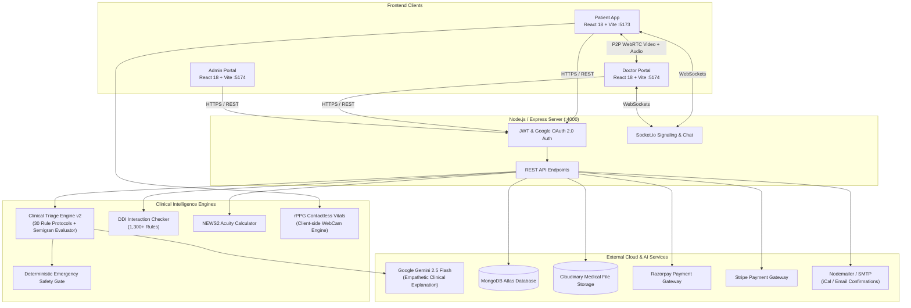

# VitalSync — Next-Generation AI-Powered Telemedicine & Remote Patient Monitoring Platform

<p align="center">
  
</p>

<p align="center">
  <strong>Bridging intelligent clinical triage, contactless biomarker monitoring, and real-time telehealth into a unified clinical-grade ecosystem.</strong>
</p>

<p align="center">
  
  
  
  
  
  
  
  
  
  
</p>

---

## 📋 Executive Overview

**VitalSync** is an enterprise-ready, full-stack telemedicine and remote patient monitoring (RPM) ecosystem designed to streamline outpatient care delivery, reduce diagnostic turnaround times, and prevent emergency under-triage. 

VitalSync combines:
1. **Clinical AI Triage Engine v2** — A dual-layer deterministic safety protocol library (30 body-system protocols, evaluated using Semigran BMJ 2015 clinical methodology) paired with constrained Google Gemini fallback for empathetic patient explanations.
2. **Contactless rPPG Vitals Estimation** — Remote Photoplethysmography pipeline running in-browser to estimate patient heart rate (BPM) via standard webcam feeds during consultations.
3. **NEWS2 Clinical Acuity Calculation** — Real-time National Early Warning Score 2 computation to risk-stratify patients (Low, Medium, High risk) before doctor consultations.
4. **Drug-Drug Interaction (DDI) Safety Engine** — Real-time screening across 1,300+ pharmacological interaction rules to flag contraindications during prescription authoring.
5. **Verified Digital Prescriptions** — Auto-generated branded PDF prescriptions with tamper-evident, cryptographically verifiable QR codes.
6. **Encrypted WebRTC Consultations & Real-Time Chat** — Peer-to-peer audio/video calling and bidirectional Socket.io messaging between verified patients and doctors.

---

## 🌟 Key Features

### 🤖 1. Clinical AI Triage Engine v2 (`backend/triage/`)
- **30 Evidence-Based Protocols**: Structured rule hierarchies spanning Dermatology, Gastroenterology, Neurology, General Medicine, and Women & Child Health.
- **100% Emergency Recall (Zero Under-Triage)**: Hardened safety gate intercepts acute emergencies (myocardial infarction, acute stroke, severe anaphylaxis, unmanaged hemorrhage, obstetric crises, acute psychiatric emergencies) and immediately triggers emergency protocols.
- **Negation Safety & Robust Normalization**: Accurately distinguishes "no chest pain" or "without fever" from positive symptoms; handles multi-word compound terms (e.g. `hairfall`), common typos, and multi-lingual/Hinglish phrasing.
- **Redundant Question Elimination**: Automatically extracts answers already provided in the chief complaint and asks only discriminating follow-up questions.
- **Body-System Fallback Picker**: Eliminates dangerous silent fallbacks to General Physicians when ambiguous symptoms are presented.
- **BMJ Evaluation Suite**: Rigorously validated with an automated 155-vignette benchmark suite (`npm --prefix backend run triage:eval`).

### 💬 2. MedBot AI Symptom Checker & Virtual Assistant
- **Dedicated Symptom Checker**: Full-page interactive triage experience with progress tracking, question chips, and clinical summary cards.
- **Persistent Floating Quick-Access Widget**: Seamlessly accessible across the application with animated avatar status (`MedBotAvatar.jsx`).
- **One-Click Specialist Handover**: Suggests matched specialists (e.g., Dermatologist, Neurologist, Gastroenterologist) based on triage outcome and pre-fills appointment booking.

### 📹 3. WebRTC Teleconsultations & Contactless rPPG Vitals
- **Peer-to-Peer HD Video Calling**: Secure WebRTC connection with adaptive bitrate, ICE candidate negotiation, screen-sharing, and mute/camera controls.
- **In-Browser rPPG Heart Rate Monitoring**: Real-time computer vision algorithm extracting facial blood volume pulse (BVP) fluctuations to compute heart rate (BPM) non-invasively through standard webcams.
- **In-Call Doctor-Patient Chat**: Side panel for textual exchanges, vital sign overlays, and clinical notes during active video calls.

### 🏥 4. Clinical Patient Onboarding & Profile Completeness
- **Onboarding Modal**: Proactively captures essential medical background:
  - Blood Group & Vitals Baseline
  - Height (cm), Weight (kg) & Automatic BMI calculation
  - Chronic Conditions (Hypertension, Diabetes, Asthma, etc.)
  - Current Medications & Dosage
  - Known Drug/Environmental Allergies (with explicit "No Known Allergies" declaration)
  - Emergency Contact Information
- **Completeness Meter**: Dynamic visual progress indicator guiding patients to achieve 100% profile completeness for enhanced clinical accuracy.

### 📊 5. NEWS2 Scoring & Remote Patient Monitoring (RPM)
- **Standardized Clinical Acuity**: Calculates NEWS2 from systolic BP, heart rate, respiration rate, SpO2, body temperature, and consciousness (AVPU scale).
- **Clinical Banding**: Color-coded risk indicators (Green/Low, Yellow/Medium, Red/High) displayed on doctor appointment lists and patient health drawers.

### 💊 6. Drug-Drug Interaction (DDI) Safety Checker
- **Real-Time Prescription Screening**: Instant cross-referencing against 1,300+ known drug-drug pairs.
- **Severity-Tiered Alerts**: Identifies Major (contraindicated), Moderate, and Minor interactions with detailed pharmacological mechanism notes before saving or issuing prescriptions.

### 📜 7. Digital Prescriptions & QR Verification
- **Digital Rx Builder**: Doctor portal interface to specify medicine name, dosage, frequency, duration, and patient advice.
- **Verifiable QR Codes**: Each prescription includes a unique QR code allowing pharmacies or patients to verify authenticity independently.
- **Branded PDF Export**: Automated high-resolution PDF generation with clinic header, doctor credentials, and digital signature using PDFKit.

### 💳 8. Multi-Gateway Payment & Automated Calendar Delivery
- **Flexible Payments**: Seamless integration with **Razorpay** and **Stripe**, alongside a dedicated developer Test Mode for staging environments.
- **Calendar & Email Automation**: Sends appointment confirmations, direct video consultation links, and `.ics` calendar invites via Nodemailer (Gmail / Brevo / Ethereal sandbox).

### 🛡️ 9. Unified Doctor & Admin Portals (`admin/`)
- **Doctor Workspace**:
  - Live consultation queue and appointment calendar
  - Slide-out **Patient Health Drawer** displaying historical vitals, previous prescriptions, uploaded labs, and allergies
  - Interactive video consultation room with live vitals overlay
  - Practice earnings and payout analytics
- **Admin Control Center**:
  - Doctor credential verification and onboarding approval
  - Global patient records management
  - Platform-wide appointment monitoring and revenue statistics

---

## 🏛️ System Architecture



---

## 📂 Project Structure

```text
vitalsync/
├── admin/                         # Doctor & Admin Management Portal (React 18 + Vite)
│   ├── src/
│   │   ├── components/            # PatientHealthDrawer, DDIAlertPanel, DoctorChatWindow, etc.
│   │   ├── context/               # AdminContext, DoctorContext, AppContext
│   │   ├── pages/
│   │   │   ├── Admin/             # Dashboard, DoctorsList, AddDoctor, PatientsList, Appointments
│   │   │   └── Doctor/            # DoctorDashboard, DoctorAppointments, DoctorVideoCall, PrescriptionForm
│   │   └── utils/                 # NEWS2 Calculator, WebRTC Call Hook, Appointment Utilities
│   ├── package.json
│   └── vite.config.js
│
├── backend/                       # Node.js / Express REST API & Real-time Server
│   ├── config/                    # MongoDB, Cloudinary, and Gemini AI configurations
│   ├── controllers/               # aiController, chatbotController, userController, doctorController,
│   │                              # prescriptionController, ddiController, vitalsController, etc.
│   ├── data/                      # 1,300+ Drug-Drug Interaction rules (ddiDatabase.js)
│   ├── middleware/                # authAdmin, authDoctor, authUser, multer upload middleware
│   ├── models/                    # userModel, doctorModel, appointmentModel, prescriptionModel, etc.
│   ├── routes/                    # Express routing tables for all platform features
│   ├── triage/                    # Clinical Triage Engine v2
│   │   ├── protocols/             # 30 structured protocols (general, digestive, neuro, skin, womenChild)
│   │   ├── __tests__/eval.js      # 155-vignette Semigran BMJ clinical evaluation benchmark
│   │   ├── classifier.js          # Symptom lexicon, typo matcher, compound parser
│   │   ├── engine.js              # Triage orchestrator & ring-buffer audit logger
│   │   ├── llm.js                 # Constrained Gemini explanation generation
│   │   ├── normalize.js           # Multi-lingual & Hinglish normalization rules
│   │   ├── router.js              # Deterministic routing logic
│   │   └── safetyGate.js          # Deterministic life-threatening red-flag detector
│   ├── utils/                     # EmailService, PDFGenerator, QRGenerator
│   ├── server.js                  # Entry point, HTTP server, socket initialization, security headers
│   └── package.json
│
├── frontend/                      # Patient-Facing Web Application (React 18 + Vite)
│   ├── src/
│   │   ├── assets/                # Platform logos, doctor avatars, medical icons
│   │   ├── components/            # ChatWidget, MedBotAvatar, PatientOnboardingModal, BiomarkerChart,
│   │   │                          # StandaloneVitals, VitalsOverlay, Navbar, Footer
│   │   ├── context/               # AppContext (Auth state, profile completeness, triage sessions)
│   │   ├── pages/                 # Home, Doctors, Appointment, SymptomChecker, VideoCall,
│   │   │                          # HealthHub, HealthDashboard, MedicalRecords, MyProfile, MyAppointments
│   │   └── utils/                 # rppgEngine.js, useWebRTCCall.js, news2Calculator.js, profileCompleteness.js
│   ├── package.json
│   └── vite.config.js
│
├── package.json                   # Root package descriptor
└── README.md                      # Project documentation
```

---

## 🛠️ Technology Stack

| Layer | Technologies |
| :--- | :--- |
| **Frontend (Patient)** | React 18, Vite 5, Tailwind CSS 3, Lucide React, Socket.io Client, Axios, React Router 6, React Toastify |
| **Admin & Doctor Portal** | React 18, Vite 5, Tailwind CSS 3, WebRTC (`RTCPeerConnection`), Lucide React, Socket.io Client |
| **Backend API Server** | Node.js (ES Modules), Express 4.19, Socket.io 4.8, HTTP/DNS fallback |
| **Database & ODM** | MongoDB Atlas, Mongoose 8.5 |
| **Artificial Intelligence** | Google Gemini 2.5 Flash (`@google/generative-ai`), Custom Clinical Triage Engine v2 |
| **Real-time Media & Video** | WebRTC (Mesh P2P), Socket.io Signaling, Canvas 2D Computer Vision (rPPG Heart Rate Extraction) |
| **File Storage & PDFs** | Cloudinary v2 (Medical records/Avatars), PDFKit 0.19 (Vector Prescriptions), QRCode 1.5 |
| **Security & Auth** | JSON Web Tokens (JWT), Bcrypt.js, Google OAuth 2.0 (`@react-oauth/google`, `google-auth-library`) |
| **Payment Gateways** | Razorpay Node SDK, Stripe Node SDK, Development Mock Payment Mode |
| **Mailing & Calendar** | Nodemailer (Ethereal fake SMTP sandbox, Gmail App Passwords, or Brevo SMTP relay) |

---

## 🚀 Getting Started

### Prerequisites

Ensure you have the following installed on your workstation:
- **Node.js**: v18.0.0 or higher
- **npm**: v9.0.0 or higher
- **MongoDB**: A running local instance or a free [MongoDB Atlas Cluster](https://www.mongodb.com/cloud/atlas)
- **Cloudinary Account**: For medical image and lab report uploads ([Cloudinary](https://cloudinary.com/))
- **Google Gemini API Key**: Free key from [Google AI Studio](https://aistudio.google.com/)

---

### Step 1: Clone the Repository

```bash
git clone https://github.com/bharathraj1614/vitalsync.git
cd vitalsync
```

---

### Step 2: Configure Environment Variables

Create `.env` files in each of the three workspaces based on the provided examples:

#### 1. Backend (`backend/.env`)
```ini
PORT=4000
CURRENCY="INR"
JWT_SECRET="your_super_secret_jwt_key_here"

# Admin Initial Credentials
ADMIN_EMAIL="admin@vitalsync.com"
ADMIN_PASSWORD="YourSecureAdminPassword123"

# Database & Media Cloud
MONGODB_URI="mongodb+srv://<username>:<password>@cluster.mongodb.net/vitalsync"
CLOUDINARY_NAME="your_cloudinary_cloud_name"
CLOUDINARY_API_KEY="your_cloudinary_api_key"
CLOUDINARY_SECRET_KEY="your_cloudinary_secret_key"

# Payment Gateways (Optional for local testing if PAYMENT_TEST_MODE="true")
RAZORPAY_KEY_ID="rzp_test_your_key_id"
RAZORPAY_KEY_SECRET="your_razorpay_secret"
STRIPE_SECRET_KEY="sk_test_your_stripe_secret_key"
PAYMENT_TEST_MODE="true"

# Google Gemini AI Studio
GEMINI_API_KEY="your_gemini_api_key_here"

# Google OAuth 2.0 (Optional)
GOOGLE_CLIENT_ID="your_google_client_id.apps.googleusercontent.com"
GOOGLE_CLIENT_SECRET="your_google_client_secret"

# Email Delivery (Leave unset to use Ethereal Sandbox automatically)
# SMTP_USER="your-email@gmail.com"
# SMTP_PASS="your-16-char-app-password"
```

#### 2. Frontend (`frontend/.env`)
```ini
VITE_BACKEND_URL="http://localhost:4000"
VITE_RAZORPAY_KEY_ID="rzp_test_your_key_id"
VITE_GOOGLE_CLIENT_ID="your_google_client_id.apps.googleusercontent.com"
```

#### 3. Admin & Doctor Portal (`admin/.env`)
```ini
VITE_CURRENCY="₹"
VITE_BACKEND_URL="http://localhost:4000"
VITE_GOOGLE_CLIENT_ID="your_google_client_id.apps.googleusercontent.com"
```

---

### Step 3: Install Dependencies

Install packages across backend, frontend, and admin:

```bash
# Backend dependencies
npm --prefix backend install

# Patient Frontend dependencies
npm --prefix frontend install

# Admin & Doctor Portal dependencies
npm --prefix admin install
```

---

### Step 4: Run the Platform

Start each application in a separate terminal:

#### Terminal 1 — Backend Server
```bash
npm --prefix backend run server
# Starts API and Socket.io server on http://localhost:4000
```

#### Terminal 2 — Patient Web App
```bash
npm --prefix frontend run dev
# Launches patient interface on http://localhost:5173
```

#### Terminal 3 — Doctor & Admin Management Portal
```bash
npm --prefix admin run dev
# Launches Doctor & Admin interface on http://localhost:5174
```

---

## 🧪 Testing & Evaluation

### Clinical Triage Engine Evaluation Suite

VitalSync includes a specialized validation suite evaluated against the clinical methodology established by Semigran et al. (*BMJ 2015;351:h3480*). It executes:
1. **Schema Check**: Verifies that all 30 protocol definitions conform to required decision tree schemas.
2. **Multi-Turn Regression Check**: Tests prefilling, state transition, and question-skipping behavior.
3. **Safety Fallback Check**: Confirms unknown symptoms present a body-system picker rather than silent general practice default.
4. **155-Vignette Benchmark**: Validates routing accuracy and guarantees 100% emergency recall (zero under-triage on life-threatening presentations).

To run the suite:
```bash
npm --prefix backend run triage:eval
```

Expected output:
```text
====================================================================
  CLINICAL TRIAGE ENGINE v2 — VIGNETTE EVALUATION SUITE
====================================================================

[1] Protocol Library Schema Check (30 protocols):
  ✅ 0 schema errors across all protocols.

[2] Multi-Turn Regression Check:
  ✅ Turn 1 matched protocol, pre-filled answers, and skipped redundant questions.
  ✅ Turn 2 accurately resolved primary specialty routing.

[3] Unknown Complaint Safety Check:
  ✅ Ambiguous complaint prompted body-system picker instead of silent GP default.

[4] Vignette Benchmark Results (155 vignettes):
  • Total Vignettes Tested     : 155
  • Primary Routing Accuracy   : 155/155 (100.0%)
  • Red-Flag Emergency Recall  : 26/26 (100.0%) — Under-triage: 0

====================================================================
  ALL CHECKS PASSED (100% Red-Flag Recall, 100% Vignette Accuracy)
====================================================================
```

### Production Build Verification

To confirm error-free production builds:
```bash
# Verify Patient Frontend Build
npm --prefix frontend run build

# Verify Admin & Doctor Portal Build
npm --prefix admin run build
```

---

## 📡 Primary API Endpoints

| Method | Endpoint | Description | Auth Required |
| :--- | :--- | :--- | :--- |
| `POST` | `/api/user/register` | Patient registration with initial medical profile | None |
| `POST` | `/api/user/login` | Patient authentication & JWT issue | None |
| `POST` | `/api/user/google-auth` | Google OAuth 2.0 single sign-on | None |
| `GET` | `/api/user/get-profile` | Fetch patient profile, allergies, and chronic conditions | User Token |
| `POST` | `/api/user/update-profile` | Update profile, vitals baseline, and emergency contacts | User Token |
| `POST` | `/api/user/book-appointment` | Schedule doctor appointment slot | User Token |
| `POST` | `/api/chatbot/triage` | Multi-turn Clinical AI Triage turn execution | None / Optional |
| `GET` | `/api/doctor/list` | List verified active physicians with specialties | None |
| `POST` | `/api/doctor/login` | Doctor portal authentication | None |
| `POST` | `/api/prescription/generate` | Generate verified digital prescription with QR code | Doctor Token |
| `GET` | `/api/prescription/verify/:id` | Public cryptographic verification of prescription | None |
| `POST` | `/api/ddi/check` | Analyze multi-drug combinations for adverse interactions | None / Token |
| `GET` | `/api/vitals/history` | Retrieve longitudinal vital signs and biomarkers | User Token |
| `POST` | `/api/records/upload` | Upload lab reports, radiological imaging, or clinical records | User Token |
| `POST` | `/api/admin/add-doctor` | Onboard and verify new healthcare provider | Admin Token |

---

## 🔒 Security, Compliance & Privacy

- **Data Protection**: Sensitive patient health information (allergies, medications, chronic conditions) is scoped strictly by JWT authentication.
- **Peer-to-Peer Encryption**: Audio and video teleconsultation streams travel directly between patient and doctor browsers via encrypted WebRTC DTLS/SRTP channels.
- **Tamper-Evident Prescriptions**: Prescriptions are indexed with cryptographic hashes and QR identifiers preventing post-issuance alterations.
- **Client-Side rPPG Processing**: Video frames for contactless heart rate analysis are analyzed in local browser memory via HTML5 Canvas and are never transmitted or stored on remote servers.

---

## ⚕️ Clinical Disclaimer

> **IMPORTANT MEDICAL NOTICE**:  
> VitalSync and its integrated MedBot Symptom Checker are designed for **clinical decision support, informational guidance, and outpatient coordination only**. VitalSync does **NOT** provide definitive medical diagnoses and does **NOT** replace in-person consultation with a licensed physician. If you or someone around you is experiencing severe symptoms—such as crushing chest pain, sudden facial droop or weakness, severe respiratory distress, uncontrollable bleeding, or acute psychiatric crisis—immediately contact your local emergency services (e.g., 911, 112, or 108) or proceed to the nearest emergency room.

---

## 👨‍💻 Author & Contributions

- **Lead Developer**: Bharathraj B ([@bharathraj1614](https://github.com/bharathraj1614))
- **Repository**: [https://github.com/bharathraj1614/vitalsync](https://github.com/bharathraj1614/vitalsync)

Contributions, feature suggestions, and bug reports are welcome! Please open an issue or submit a pull request.

---

## 📄 License

This project is licensed under the [ISC License](LICENSE).
